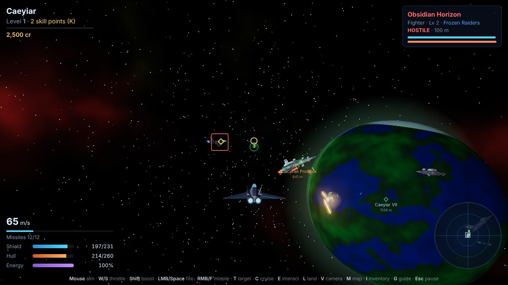
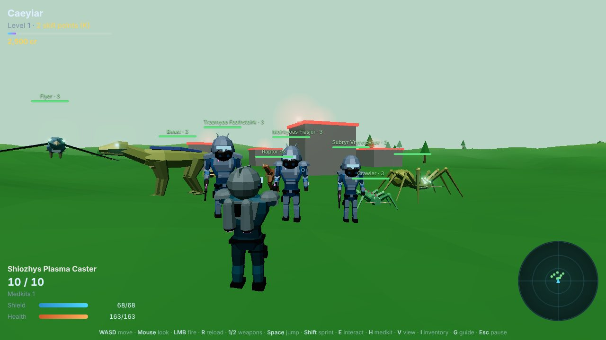
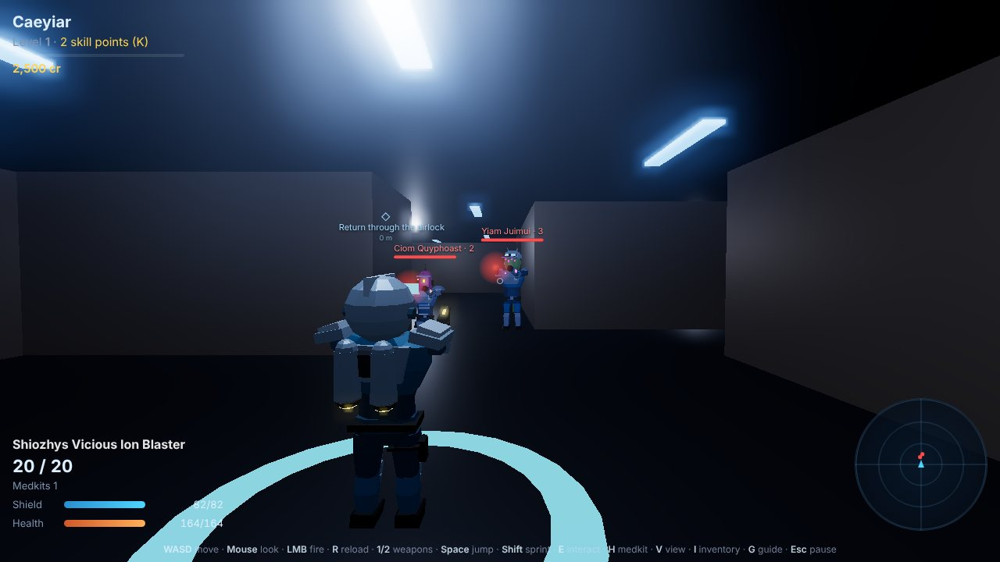
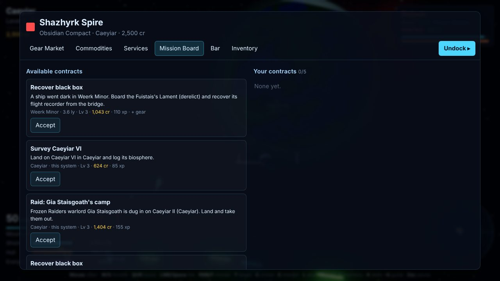
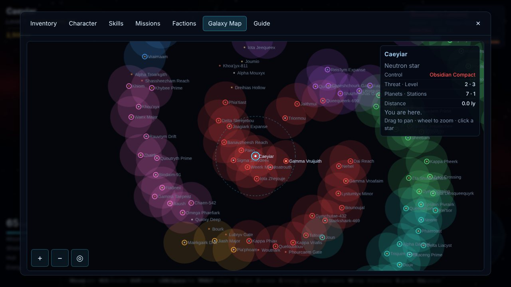

<div align="center">

# STARWARD

**A procedural open-universe space sandbox RPG that runs in your browser.**

Fly, fight, trade, land on planets, board and capture ships, and build a captain in a galaxy generated from a seed.

### [▶ Play now — cptnope.github.io/Starward](https://cptnope.github.io/Starward/)

Also on **[itch.io](https://cptnope.itch.io/starward)**, where you can follow the **[devlog](https://cptnope.itch.io/starward/devlog)** or leave a donation.

Downloads: an offline copy of the game and the **original soundtrack** are attached to each [release](https://github.com/CptNope/Starward/releases).

[Player guide](docs/PLAYER_GUIDE.md) · [Developer guide](docs/DEVELOPMENT.md) · [Changelog](CHANGELOG.md) · [Report a bug](https://github.com/CptNope/Starward/issues/new/choose)

Made by **[Jeremy Anderson Tech](https://jeremyanderson.tech/)**



</div>

## What you can do

- **Fly and fight** in arcade 6DOF space combat: mouse-aim flight, gimballed guns that lock onto a lead indicator, chase or cockpit cameras, homing missiles, boost, cruise drive, and five damage types that each hit shields and hulls differently.
- **Explore a living galaxy.** 140 star systems, seven factions with their own ideologies, territory and wars, and procedural alien species with their own naming languages. Faction fleets patrol, trade, raid and fight each other whether you're there or not.
- **Leave the ship.** Land on planets with outposts, pirate camps, alien ruins, wildlife, ore to mine and relic vaults. Disable ships, board them, fight the crew, then **claim the ship as your own** or scrap it for salvage.
- **Loot endlessly.** Gear comes in seven tiers from Scrap to Mythic, with random bonus stats, procedural names and brands. Legendary weapons roll special effects like twin shots, homing, chain lightning and piercing.
- **Meet the unexpected.** Signals pop up as you fly: distress calls, pirate ambushes, derelicts to explore, anomalies to scan, and faction battles. **Dreadnought** capital ships with independent turrets prowl the dangerous systems.
- **Mine, salvage and craft.** Mine asteroid belts for ore, crystals and relics. Salvage spare gear into parts, then use the station **Workshop** to upgrade your favorite items up to Mythic or reforge their bonuses.
- **Grow your captain.** 35 skills across 7 trees, hireable crew who give role bonuses or **fly as your wingmen**, eight hull classes, shipyards, contracts, a commodity economy and faction reputation.
- **Play anywhere.** Keyboard and mouse, gamepad, or touch. Quality adapts to the device automatically.

| | |
|---|---|
|  |  |
|  |  |

## Quick start

1. Open **[cptnope.github.io/Starward](https://cptnope.github.io/Starward/)** and choose **New game**. Pick a name, a species and a universe seed, or keep the random one.
2. Fly to the station next to you and press **E** (or tap **USE**) to dock. Take a contract and browse the gear.
3. Press **K** to spend your skill points, **M** to open the galaxy map and jump to another star, and **G** for the in-game Field Guide.

The full manual is in **[docs/PLAYER_GUIDE.md](docs/PLAYER_GUIDE.md)**, and the same guide is built into the game (press **G**).

## Controls at a glance

| Flying | | On foot | |
|---|---|---|---|
| Mouse | Steer (click to capture) | WASD · Mouse | Move · look |
| W / S · X | Throttle · all stop | LMB · R · 1 / 2 | Fire · reload · swap |
| A / D · Q / E | Yaw · roll | Space · Shift | Jump · sprint |
| Shift · C | Boost · cruise | E · H | Interact · medkit |
| LMB / Space · RMB / F | Guns · missile | | |
| T · R | Cycle targets · target ahead | **Menus** | |
| E · L | Dock / board / hail · land | I / Tab · K · J | Inventory · skills · missions |
| V · M | Camera · galaxy map | G · Esc / P | Guide · pause |

**Touch:** left thumb steers or moves, right thumb drags for throttle and roll (flying) or to look (on foot), and on-screen buttons cover everything else. **Gamepad:** standard layout; see the guide.

## Runs on any device

- Detects the device's graphics chip, memory, processor cores and input type, and picks a **Low / Medium / High** preset.
- Watches the frame rate while you play. It lowers render resolution first and drops a preset only if that isn't enough. You can override it under **Pause → Graphics**, which also has an FPS counter.
- Planet and nebula textures are generated a few rows per frame, so entering a system never freezes the game.
- Each ship, station and character is drawn in one or two draw calls, all shots are instanced, and every explosion and flash is a single particle draw.

## Run it locally

```bash
git clone https://github.com/CptNope/Starward.git
cd Starward
npm install
npm run build     # bundles src/ into dist/
npx serve dist    # or any static file server
```

See **[docs/DEVELOPMENT.md](docs/DEVELOPMENT.md)** for the architecture and how to add weapons, skills, biomes, factions and more.

## Deployment

Every push to `main` builds the game and publishes it to GitHub Pages using [`.github/workflows/pages.yml`](.github/workflows/pages.yml). In the repo settings, set **Pages → Source** to **GitHub Actions**.

## About

Starward is built by **Jeremy Anderson** of **[Jeremy Anderson Tech](https://jeremyanderson.tech/)**, a software architect and WordPress engineer in Shrewsbury, Massachusetts, who builds websites, plugins, web apps and browser games.

- 🌐 Website: **[jeremyanderson.tech](https://jeremyanderson.tech/)**
- 📅 Want something like this built? **[Book a call](https://jeremyanderson.tech/book-a-call/)**
- 🎮 Play: **[cptnope.github.io/Starward](https://cptnope.github.io/Starward/)** or **[on itch.io](https://cptnope.itch.io/starward)**
- 📝 Devlog: **[cptnope.itch.io/starward/devlog](https://cptnope.itch.io/starward/devlog)**
- 🛰️ Project page: **[jeremyanderson.tech/project/starward-threejs-space-sandbox-rpg](https://jeremyanderson.tech/project/starward-threejs-space-sandbox-rpg/)**
- 𝕏 **[@JAndersonTech](https://x.com/JAndersonTech)**

Built with [three.js](https://threejs.org/) and [esbuild](https://esbuild.github.io/). The original soundtrack in `music/` (seven instrumental tracks) was made by Jeremy Anderson with [Suno](https://suno.com/).

## License

MIT. See [LICENSE](LICENSE).
